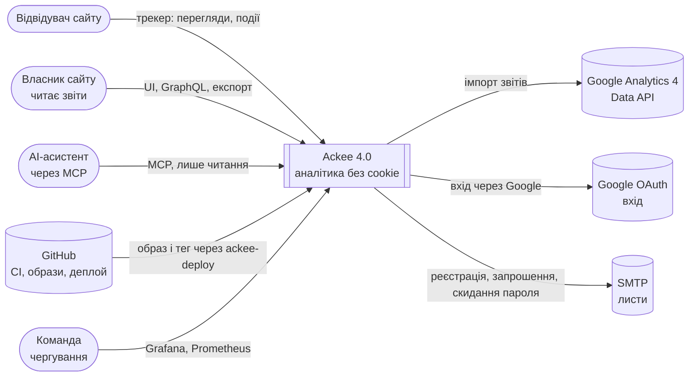
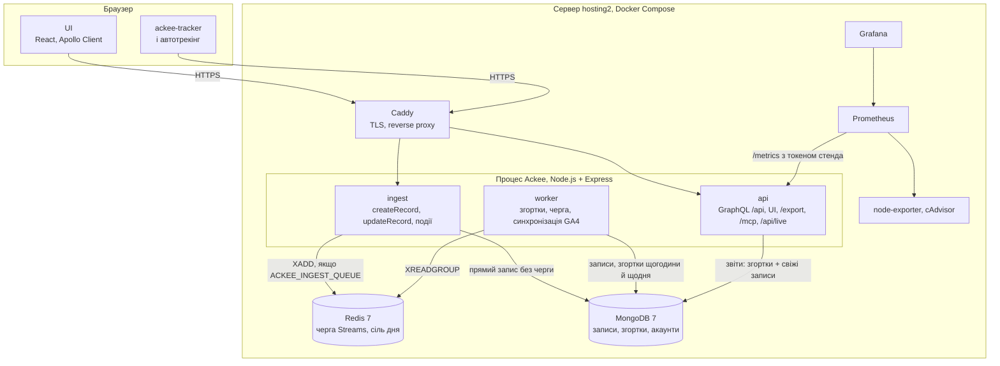

# Архітектура Ackee 4.0

Цілісна картина системи на 4.0.0. Окремі рішення та їхні причини описано в `docs/adr`. Як система працює і що робити, коли щось ламається, описано в `runbook.md`.

## Контекст (C4, рівень 1)

| Хто або що         | Навіщо                                                                                                           |
| ------------------ | ---------------------------------------------------------------------------------------------------------------- |
| Відвідувач сайту   | Трекер (`/tracker.js` або автотрекінг через Tag Manager) шле перегляд і події. Ключ прийому домену не є секретом |
| Власник сайту      | Акаунт у робочому просторі з роллю Viewer, Editor чи Owner (ADR-002, ADR-003)                                    |
| AI-асистент        | `POST /mcp`, шість інструментів звітів, лише читання, кожен виклик записано в журнал дій (ADR-008)               |
| Google Analytics 4 | Звіти GA4 поруч зі звітами Ackee. Ключі сервісного акаунта зашифровано `ACKEE_SECRET_KEY`                        |
| Google OAuth, SMTP | Вхід через Google; листи для підтвердження, запрошень і скидання пароля                                          |
| GitHub             | CI, образ `ghcr.io/voronov/ackee`, деплой на сервер через ключ, якому дозволено лише `ackee-deploy`              |

## Контейнери (C4, рівень 2)

**Ролі процесу.** `ACKEE_ROLE` вибирає, що робить процес: `all` (за замовчуванням, усе в одному), `api`, `ingest` чи `worker` (ACKEE-19). На dev і live зараз працює один процес `all` на стенд. Розділення перевірено тестами й на локальному стенді. Воно потрібне, коли важкий звіт заважає прийому подій.

**Черга.** Якщо задано `ACKEE_INGEST_QUEUE`, перегляд спершу пишеться в Redis Stream, і трекер одразу отримує відповідь, а воркер записує його в MongoDB (ADR-006). Якщо Redis недоступний, запис іде напряму, а лічильник `ackee_ingest_fallback_total` росте. Без цієї змінної Redis не потрібен. Зараз чергу ввімкнено лише на dev.

**Згортки.** Звіти не читають усі записи. Погодинні (`viewrollups`, `dimensionrollups`) і денні (`dimensiondayrollups`) згортки будує фонове завдання кожні 10 хвилин. Закриту («запечатану») годину більше не перераховують. Звіт складає згортки і записи після печатки (ADR-005, ACKEE-74, ACKEE-76). Фільтрований звіт згорток не має і читає записи: близько 4 с на 10 млн.

**Сервер.** Один VPS (4 ГБ RAM, 38 ГБ диск). На ньому `ackee-live` (`ackee2.varlex.app`, тег версії), `ackee-dev` (`dev.ackee2.varlex.app`, `sha-<коміт>` з `develop`), `ackee-v1` (3.6.1 для порівняння), спільні MongoDB з окремими базами `ackee_live` і `ackee_dev`, Redis, Prometheus, Grafana. ClickHouse запущено, але код його не використовує (ADR-004, ACKEE-17).

## Компоненти процесу Ackee

| Шлях                      | Модуль                                           | Що робить                                                                                |
| ------------------------- | ------------------------------------------------ | ---------------------------------------------------------------------------------------- |
| `/api`                    | `src/resolvers`, `src/types`                     | GraphQL. Схема є контрактом для UI, трекера, MCP і експорту (знімок у тестах, ACKEE-103) |
| `/tracker.js`, `/t/:file` | `src/autotrack`                                  | Трекер і завантажувач автотрекінгу з правилами домену                                    |
| `/export/:file`           | `src/export.js`                                  | CSV і JSON звіту з фільтрами й періодом картки, через той самий GraphQL                  |
| `POST /mcp`               | `src/mcp`                                        | MCP, шість інструментів, лише запити GraphQL без мутацій                                 |
| `/api/live`               | `src/live`                                       | SSE-стрічка нових візитів, один спільний poller на домен (ADR-007)                       |
| `/auth/google/*`          | `src/google.js`                                  | Вхід через Google                                                                        |
| `/metrics`                | `src/utils/metrics.js`                           | Метрики Prometheus за токеном стенда                                                     |
| старт процесу             | `src/index.js`, `src/database/migrations.js`     | Міграції при старті: робочий простір за замовчуванням, видалення старих індексів         |
| фонові задачі             | `src/utils/rollupJob.js`, `src/queue`, `src/ga4` | Згортки, читання черги, синхронізація GA4                                                |

## Безпека на межах

- Робочий простір є межею даних. Кожен запит до домену, події чи токена проходить через перевірку дозволів в одному місці (ADR-003). Зміни записуються в журнал дій.
- CSP: виконуються лише скрипти сторінки, з'єднання тільки зі своїм origin (ACKEE-117).
- Ключ прийому домену піднімає планку проти чужого трафіку, але секретом не є. Строгий режим вмикає власник.
- Секрети стендів лежать у `/opt/ackee/.env` на сервері і не потрапляють у репозиторій. Різницю конфігурацій між стендами показує `config-matrix.md` (ACKEE-104).

## Рішення, що лишились відкритими

| Тема                 | Стан                                                                    |
| -------------------- | ----------------------------------------------------------------------- |
| ClickHouse (ADR-004) | Спайк не дав рішення за критерієм. Сервіс запущено, у v2.0 не ввімкнено |
| Фільтрований звіт    | Читає записи, близько 4 с на 10 млн. Відоме обмеження 4.0.0             |
| Розділення процесів  | Підтримується, але на стендах не застосовано                            |
| Черга на live        | Лише на dev. На live пишемо напряму                                     |
